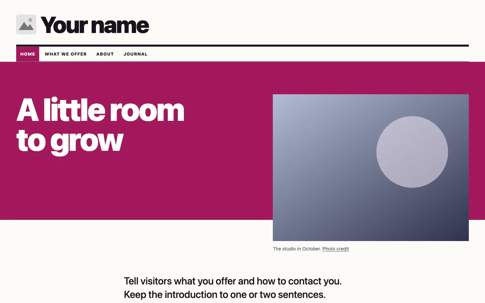
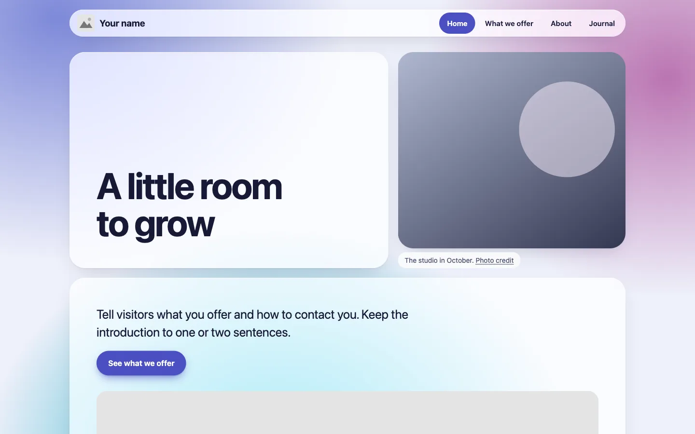
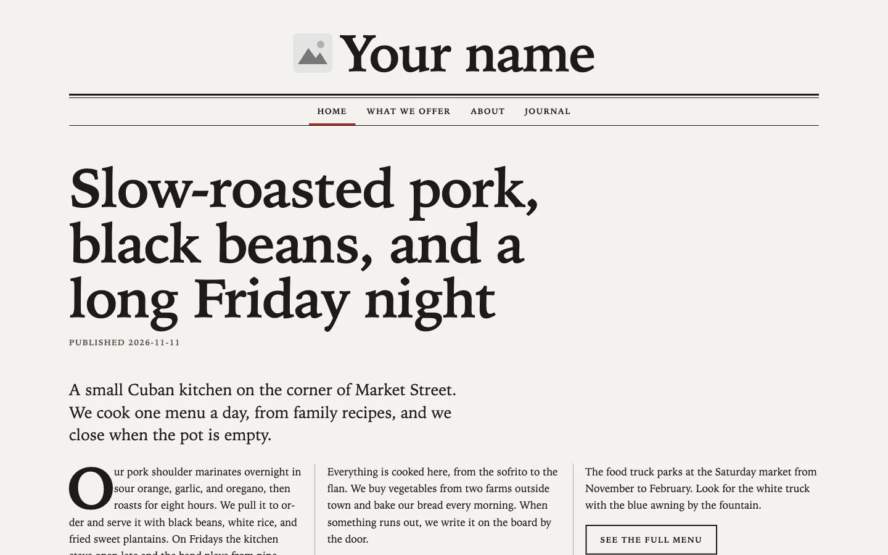
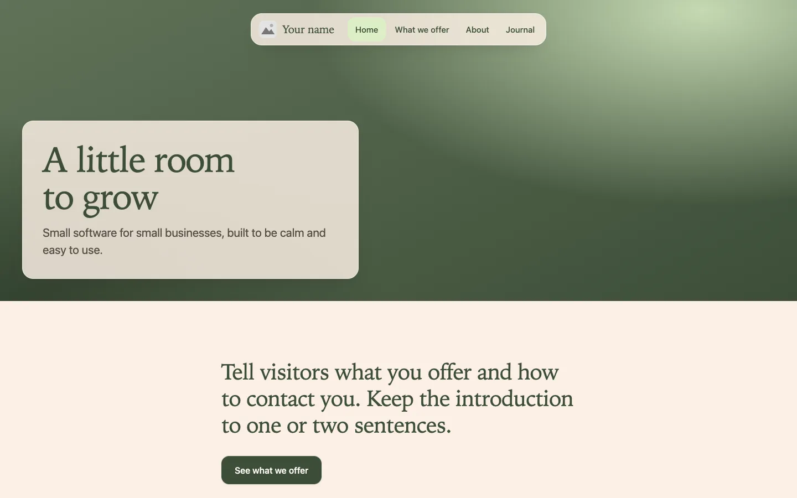

# Themes overview

Cozy Badger maintains these themes for Cress 1.x. Each one runs on Cress 1.0.0
or later and includes English and German labels. Installation is in the
[README](../README.md#install-a-theme).

## Foxglove

A magazine theme for publications and businesses that publish long articles.
Headlines use the heaviest system font weight. Page titles and list entries
without images sit on solid magenta or ink blocks. List pages lead with one
full-width entry above a grid.

Version 0.1.0. Details are in the [Foxglove README](../themes/foxglove/README.md).

## Bluebell

A rounded theme for small businesses, products, and personal sites. Content
sits on frosted glass panels over color fields made from the brand color. It
follows the visitor's light or dark setting. List pages show an even grid of
cards.

Version 0.1.0. Details are in the [Bluebell README](../themes/bluebell/README.md).

## Mariposa

A broadsheet theme for restaurants, cafés, and food trucks. Text is set in
serif system fonts on off-white newsprint, with heavy and thin rules between
sections. Landing pages run their text in columns on wide screens. Tables
suit menus and price lists.

Version 0.1.0. Details are in the [Mariposa README](../themes/mariposa/README.md).

## Woodruff

A soft forest theme for small software and product companies. Light serif
headings sit on linen paper, the menu floats as a frosted pill, and images,
code, and list cards have rounded double frames. Landing pages open with a
full-width hero and a frosted title card.

Version 0.1.0. Details are in the [Woodruff README](../themes/woodruff/README.md).
